

<picture><source media="(prefers-color-scheme: dark)" srcset="assets/hero-dark.svg"></picture>

<picture><source media="(prefers-color-scheme: dark)" srcset="assets/social-l-dark.svg"></picture><a href="https://t.me/forgetmyalias"><picture><source media="(prefers-color-scheme: dark)" srcset="assets/social-1-dark.svg"></picture></a><a href="https://discord.com/users/1105557313651224648"><picture><source media="(prefers-color-scheme: dark)" srcset="assets/social-2-dark.svg"></picture></a><picture><source media="(prefers-color-scheme: dark)" srcset="assets/social-r-dark.svg"></picture>

<picture><source media="(prefers-color-scheme: dark)" srcset="assets/about-dark.svg"></picture>

<picture><source media="(prefers-color-scheme: dark)" srcset="assets/stack-dark.svg"></picture>

<a href="https://github.com/ForGetMyAlias/UptimeMonitor"><picture><source media="(prefers-color-scheme: dark)" srcset="assets/project-uptimemonitor-dark.svg"></picture></a>&nbsp;<a href="https://github.com/ForGetMyAlias/auth-api"><picture><source media="(prefers-color-scheme: dark)" srcset="assets/project-auth-api-dark.svg"></picture></a>

<a href="https://github.com/ForGetMyAlias/ttlbox"><picture><source media="(prefers-color-scheme: dark)" srcset="assets/project-ttlbox-dark.svg"></picture></a>&nbsp;<a href="https://github.com/ForGetMyAlias/trollSS"><picture><source media="(prefers-color-scheme: dark)" srcset="assets/project-trollss-dark.svg"></picture></a>

<picture><source media="(prefers-color-scheme: dark)" srcset="assets/stats-dark.svg"></picture>

<picture><source media="(prefers-color-scheme: dark)" srcset="assets/streak-dark.svg"></picture>

<picture><source media="(prefers-color-scheme: dark)" srcset="assets/wave-dark.svg"></picture>

<a href="https://github.com/ForGetMyAlias?tab=repositories"><picture><source media="(prefers-color-scheme: dark)" srcset="assets/button-1-dark.svg"></picture></a>

<a href="https://metawka.github.io/expressive-profile/?from=ForGetMyAlias"><picture><source media="(prefers-color-scheme: dark)" srcset="assets/credit-dark.svg"></picture></a>

